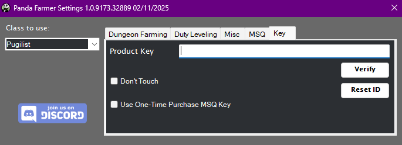
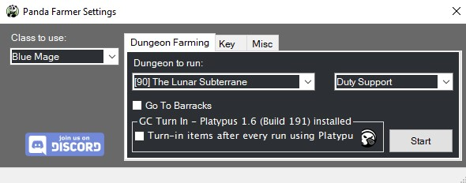
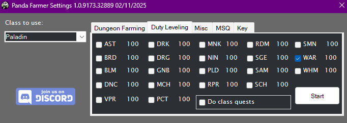
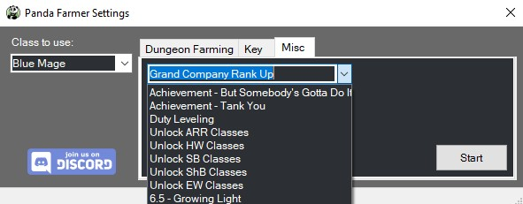
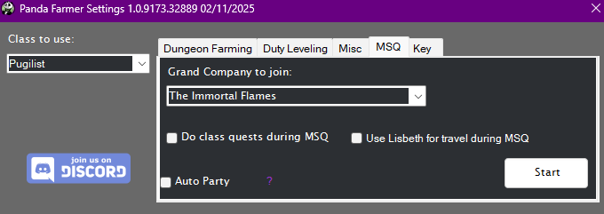

<!-- Use literal feature names and concrete instructions rather than promotional slogans.
     Keep this original-interface manual distinct from WPF beta instructions. Feature summaries
     lead into the existing task instructions; long historical lists live in reference.md. -->

PANDA FARMER · ORIGINAL INTERFACE<a href="../pandafarmerwpf/readme/">Using the WPF beta? Open its guide →</a>

USER GUIDE<h1>Panda Farmer</h1>
Panda Farmer is a RebornBuddy plugin for dungeon farming, job leveling, and MSQ. It also includes tools for class quests, Grand Company ranks, Aether Currents, and selected achievements and events.

<a class="fg-button fg-button-primary" href="#getting-started">Get started ↓</a><a class="fg-button" href="../../purchase/DW/purchase/#farmer">Plans &amp; pricing ↗</a>

## Features

<a href="#dungeon-farming"><strong>Dungeon Farming</strong>
Choose a dungeon, job, and queue mode. Set whether to return to your barracks or turn in gear between runs.
How to set up a run →</a>
<a href="#duty-leveling"><strong>Duty Leveling</strong>
Select the jobs you want to level. Farmer chooses leveling duties and can complete class quests as you go.
Leveling settings →</a>
<a href="#msq"><strong>Main Story Quests</strong>
Run the story profiles with class quests and flight unlocks. Some quests and duties still need to be completed manually.
MSQ setup and limitations →</a>

<a href="#character-progression"><strong>Character tools</strong>Class unlocks, Grand Company, and Aether Currents →</a><a href="#achievements"><strong>Achievements &amp; side quests</strong>Achievement routes, side quests, and squadrons →</a><a href="#blunderville-fall-guys-crossover"><strong>Events</strong>Supported seasonal and crossover activities →</a>

<strong>Additional features in the WPF beta</strong>
Beastmaster tools, Variant Dungeons, and Mogpendium planning are covered in the <a href="../pandafarmerwpf/readme/">WPF beta guide</a>. Use that guide if your Farmer window has the redesigned sidebar.

## Getting started

<a href="#requirements">1
<strong>Prepare</strong>
Check dependencies and choose your license.

</a><a href="#installation">2
<strong>Install &amp; activate</strong>
Add Farmer to RB and verify your key.

</a><a href="#dungeon-farming">3
<strong>Choose an activity</strong>
Review its options, then start your first run.

</a>

Observe your first attempt on a new activity. Available duties and profile quality vary by job, queue mode, character unlocks, and installed version. Follow prompts when manual content is needed.

## Requirements

- [RebornBuddy][7] with active license (paid)
- [Lisbeth][9] with active license (paid)
- [LlamaLibrary][10] (free)
- [LlamaUtilities](https://github.com/nt153133/LlamaUtilities) (free)
- [Platypus](https://rbplatypus.com/) (free+)
- [Duty Mechanics](https://github.com/LlamaMagic/DutyMechanic) (free)

## Access and trial

To request a **72-hour trial**, join [Discord][4] and use `/trial` in **#bot-spam**.

Choose a **$5 monthly subscription**, **$5 prepaid 30-day key**, or **$15 prepaid 90-day key** on the [purchase page](../../purchase/DW/purchase.md#farmer). Prepaid keys do not auto-renew.

The optional [Variant Dungeons add-on](../pandafarmerwpf/readme.md#variant-dungeons) has separate activation and requires active Panda Farmer access.

## Installation

1. Close RebornBuddy before changing plugin files. Back up an existing installation and its settings first.
2. [Download the complete Panda Farmer ZIP](https://downloads.llamamagic.net/plugins/PandaFarmer/PandaFarmer.zip).
3. Right-click the ZIP, then choose **Properties → Unblock → Apply**, if Windows offers it.
4. Extract the complete archive into `RebornBuddy\Plugins\PandaFarmer\`. Avoid an extra nested folder.
5. Restart RebornBuddy attached to your intended character, enable Panda Farmer, and open its settings.
6. Enter your key on the [Key tab](#key) and select **Verify**.

Keep only one Farmer installation. Do not mix original and beta loader files. To migrate to the redesigned version, follow the [WPF beta installation guide](../pandafarmerwpf/readme.md#install-or-migrate).

## Key
??? example "View the original interface screenshot"
    { .farmer-manual-image }

Enter your **Product Key** and select **Verify**. Resolve activation errors before starting an activity. Keep your key private in logs and screenshots.

- **Reset ID:** The original interface offers a one-use reset for character and computer bindings, for example after reinstalling Windows. Contact support if you need another reset.
- **Older MSQ-only keys:** These cover MSQ through Endwalker. Dawntrail requires standard Panda Farmer access; an MSQ-only key is not a full Farmer license.
- **Don't touch:** Leave this testing checkbox unchecked.

## Dungeon Farming
??? example "View the original interface screenshot"
    { .farmer-manual-image }

Use this tab to repeat a supported dungeon.

1. Choose **Class to Use** on the left.
2. Select the dungeon and an available queue mode.
3. Open **Settings** to review greetings, departure delay, **Go To Barracks**, and gear turn-ins.
4. Review Platypus settings using its icon, then press **Start**.

Platypus must be installed for the dungeon profiles, even if you use another combat routine. Select **Install Platypus** if prompted. If the installer cannot restart RebornBuddy, close and reopen RB yourself.

### Star ratings
The star rating describes the profile's intended quality. Read it together with your job, queue mode, and character readiness; it is not a guarantee of a flawless run.

| Rating | How to interpret it |
| --- | --- |
| ★★★★★ | Highest-rated catalog profiles. Observe your first run before relying on them. |
| ★★★★☆ | More developed mechanics, generally intended for NPC-supported runs. |
| ★★★☆☆ | Basic progression coverage; unrestricted farming may be more suitable. |
| ★★☆☆☆ | Limited encounter handling; primarily intended for appropriately leveled unrestricted runs. |
| ★☆☆☆☆ | Known reliability limitations. Expect intervention and consider another route. |

### Settings

- **Hello / Goodbye / wait time:** Configure party messages and the delay before leaving.
- **Go To Barracks:** Choose whether to return to your Grand Company barracks between runs.
- **Turn In Every Run:** Review this before starting if you want to keep dungeon gear.
- **Run Seasonal Events When Available:** Allows supported event quests to run before your selected activity. Disable it when you want to start the selected activity directly.

The [greeting and integration reference](reference.md#greetings-and-advanced-integration) contains the full message lists and advanced profile notes.

## Duty leveling
??? example "View the original interface screenshot"
    { .farmer-manual-image }

Choose the jobs you want to train and press **Start**. Supported job unlocks and class quests are handled along the way. The tab updates job levels as your character progresses.

Keep **Do Class Quests** enabled: these quests can unlock needed abilities. Review **Go To Barracks** and **Turn In Every Run** on Dungeon Farming, since Duty Leveling uses those preferences.

See the [historical leveling routes](reference.md#historical-leveling-routes) for the original guide's dungeon list. The installed version's available options take precedence.

## Misc

{ .farmer-manual-image }

These focused profiles use **Class to Use**, barracks, and gear turn-in preferences where relevant.

### Character progression

| Tool | What it does |
| --- | --- |
| **1–50 Current Class** | Levels the current class to 50, then stops. Respects class quest settings; does not do MSQ. |
| **1–Housing** | Works through the story and Grand Company steps used by the housing-unlock profile. |
| **New Character To Retainer** | Progresses a new character to the retainer unlock, then stops. |
| **Unlock Classes** | Runs supported class/job unlock profiles. |
| **Current Class Quests** | Runs supported class quests for the job selected in the dropdown. |
| **Aether Currents** | Collects supported field currents and completes current-related quests for flight unlocks. |
| **Grand Company Rank Up** | Works toward Second Lieutenant using quests and seal turn-ins. The required duties can limit lower-level characters; prepare for unrestricted entry where Duty Support is unavailable. |
| **Dawntrail Wachumeqimeqi Deliveries** | Runs the selected level 100 crafting/gathering delivery quests using Lisbeth. |
| **Dawntrail Role Quests** | Runs selected role quest chains. The original profiles require manual final solo duties. |

### Achievements

| Goal | Activity |
| --- | --- |
| **But Somebody's Gotta Do It** | Garuda EX farming for supported tank mount achievements. |
| **Tank You, Class III** | Sirensong Sea farming for supported tank mount achievements. |
| **All the More Region to Leve VI** | Whitebrim leve farming until your allowances run out. |
| **Straight B's** | B-rank hunt targets for the achievement. |

### AutoParty

Prepare a high-level carry character and a second character for supported duties.

1. On the lower-level character, enable **Use AutoParty** in MSQ and enter the carry character's name for automatic invitations.
2. On the carry character, use the same server, open **Misc → AutoParty**, and press **Start**.
3. Wait for the carry character to reach Aleport and log **Waiting on party invite**.
4. Start MSQ on the lower-level character. Supported carry steps invite the prepared character.
5. For a manual queue, invite the carry character and select the intended duty as **Unrestricted Party**.
6. The carry character accepts supported queues, loads the duty profile, and leaves afterward to wait for another queue.

Both characters need the appropriate setup and content access. Availability depends on the duty and installed version.

### Side quests and squadrons

**Side Quests** runs the regional quest collections exposed by your installed version. Coverage is not universal.

**Squadrons** runs the Command Missions available in its selection menu. Unlock and prepare your Grand Company squadron first.

**Under the Armor** repeats this guildhest once unlocked. It does not unlock the preceding guildhests.

### Blunderville - Fall Guys Crossover

During the event, the original workflow queues participation attempts, leaves after elimination, and stops at its MGF cap. It does not automate full wins. Platypus provides event-item purchase options.

### Yo-kai Watch

During the event, choose a zone and medal targets, then start farming. Medal exchanges are manual. Select **Go to Yo-Kai vendor** and press **Start** for travel to the exchange vendor.

## MSQ
??? example "View the original interface screenshot"
    { .farmer-manual-image }

The MSQ workflow brings story profiles, supported Duty Support dungeons, class quests, snipe events, and flight-unlock steps together. Profiles cover expansions from A Realm Reborn through Dawntrail; some quests and duties need manual intervention.

1. Choose your job and review the MSQ settings.
2. Enable class quests, optional unlocks, and Aether Current progression where your version exposes those options.
3. Choose a Grand Company if your character has not joined one.
4. Configure **Use AutoParty** only when a second carry character is prepared. See [AutoParty](#autoparty).
5. Start the workflow and follow any prompts for manual content.

**Use Lisbeth for travel during MSQ** is an alternative for navigation trouble. In the original interface, it changes the travel behavior and does not learn Aetherytes through RB's normal navigation path.

Some encounters have limited mechanics handling. Watch unfamiliar duties and use a suitable job and gear. Follow prompts when the workflow needs help; a stopped or interrupted step is not proof of completion.

The [historical manual-step reference](reference.md#historical-msq-interventions) preserves the original guide's intervention list. Follow the installed version when its behavior differs.

## Troubleshooting and support

| Problem | Check first |
| --- | --- |
| Plugin does not appear | ZIP blocking, extracted folder location, complete package, and duplicate loaders. Restart RB after correcting files. |
| Your interface looks different | Use the [WPF beta guide](../pandafarmerwpf/readme.md) for the redesigned sidebar. |
| Activation fails | Correct key, expiry, and character/computer binding. Contact support without posting your key publicly. |
| An activity is unavailable | Character unlocks, job, licenses, dependencies, and installed version. |
| A run repeatedly gets stuck | Save the relevant RB log and note the version, job, duty, queue mode, and expected result. |

Join [Discord](https://discord.gg/CucSWEhJSZ) for help. Include a short description and the relevant log timestamps. Long greeting lists and the original MSQ manual-step list remain in the [historical reference](reference.md).

[3]: https://img.shields.io/badge/Discord-7389D8?logo=discord&logoColor=ffffff&labelColor=6A7EC2
[4]: https://discord.gg/CucSWEhJSZ "Discord"
[5]: https://shields.io/badge/-Buy%20me%20a%20coffee-FF5E5B?logo=kofi&logoColor=ffffff&labelColor=FF5E5B
[6]: https://ko-fi.com/domesticwarlord86 "Donate via Ko-Fi"
[7]: https://www.rebornbuddy.com/ "RebornBuddy"
[8]: https://github.com/LlamaMagic/ExBuddy "ExBuddy"
[9]: https://www.siune.io/ "Lisbeth"
[10]: https://github.com/nt153133/__LlamaLibrary "LlamaLibrary"
[11]: https://discord.gg/rDsFbKr "Magitek Discord"
[12]: https://github.com/Zimgineering/repoBuddy "RepoBuddy"
